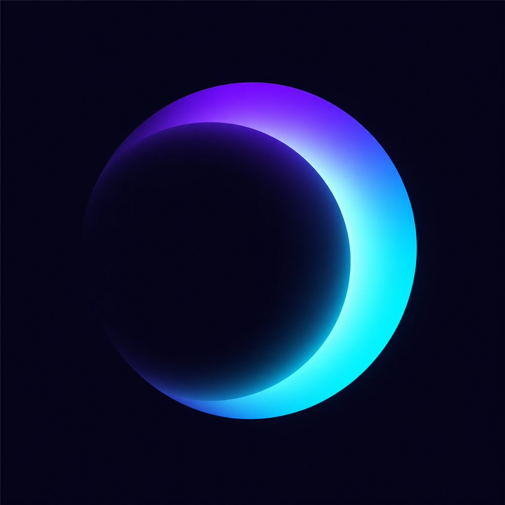
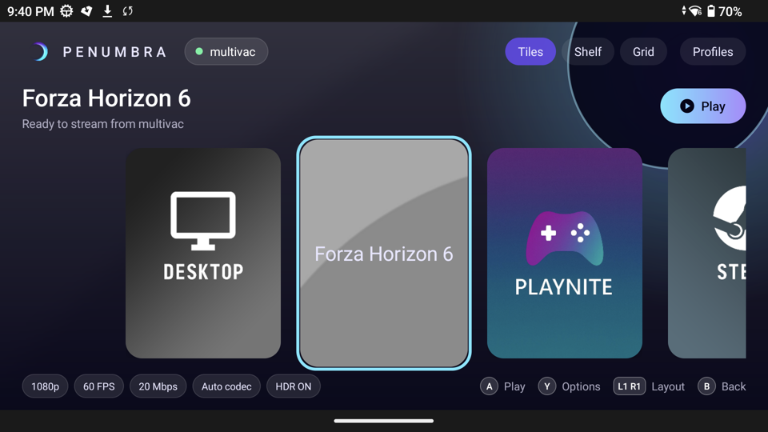
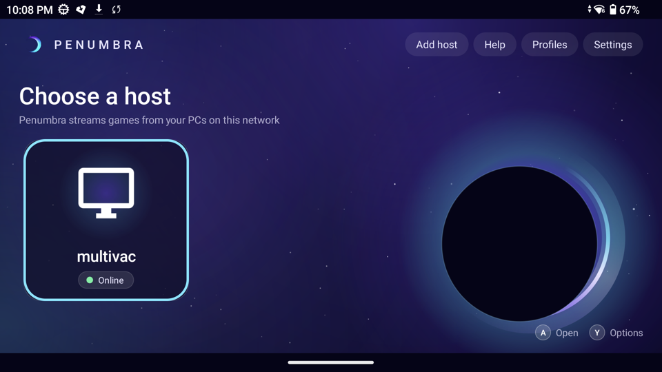
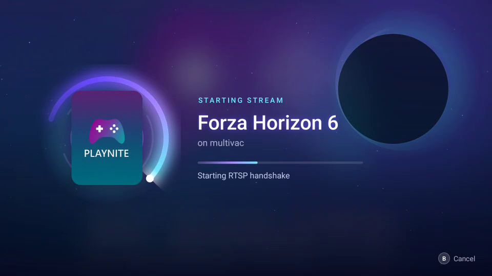
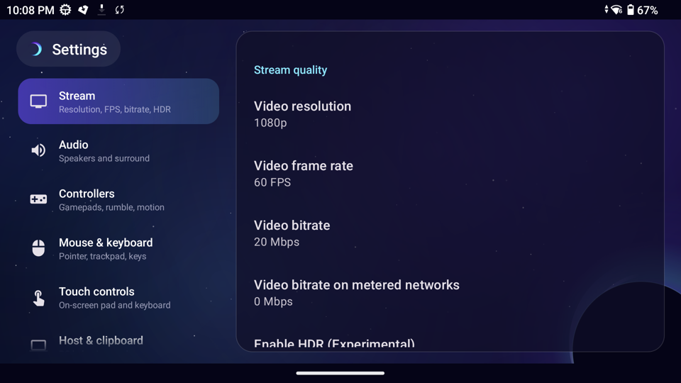
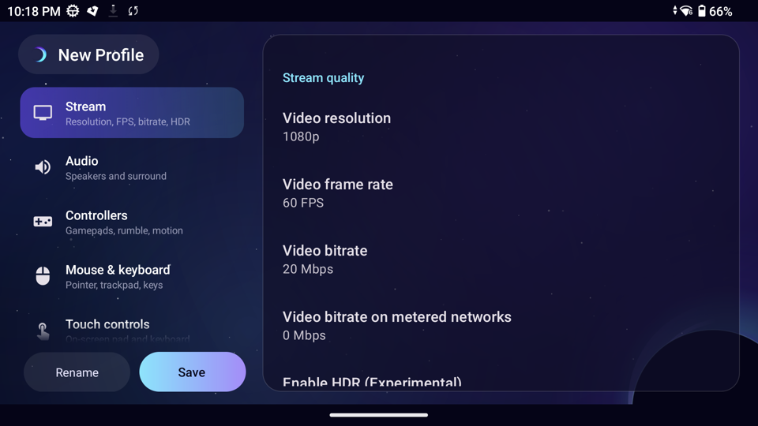
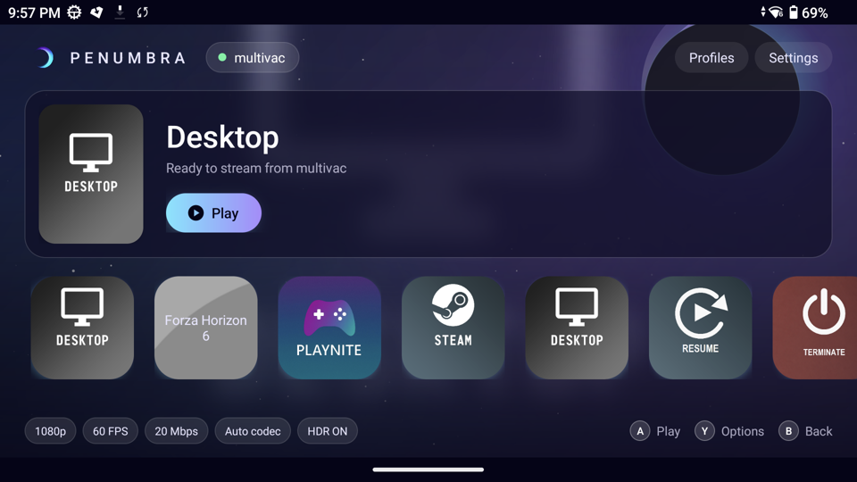

<p align="center">
  
</p>

<h1 align="center">Penumbra</h1>

<p align="center">
  <b>Stream your PC games to an Android handheld, with a console-style UI built for controllers.</b><br>
  A client for <a href="https://github.com/ClassicOldSong/Apollo">Apollo</a> / <a href="https://github.com/Nonary/Vibepollo">Vibepollo</a> / <a href="https://github.com/LizardByte/Sunshine">Sunshine</a>, forked from <a href="https://github.com/ClassicOldSong/moonlight-android">Artemis</a> and <a href="https://github.com/moonlight-stream/moonlight-android">Moonlight</a>.
</p>

<p align="center">
  
</p>

## Why Penumbra

Moonlight and Artemis are excellent streaming engines with a phone-era interface. Penumbra keeps their engine and puts it in an interface built for devices like the AYN Odin, AYN Thor, Retroid Pocket and Ayaneo handhelds:

- **Controller first.** Every screen works with the D-pad and face buttons. A is select, B is back, Y is options. Focus is always visible, and the first press lands where you expect.
- **Looks like it belongs on a console.** Animated eclipse backdrop, cover-art tiles, glass panels and soft motion throughout. The whole app runs fullscreen.
- **Frame rate that matches the stream.** Artemis could present fewer frames than the host sent. Penumbra fixes that (see [What's changed](#whats-changed)).
- **Fewer dead ends.** Switching games while another one is still running on the host now asks to close it, instead of failing with "error 410".

## Screenshots

| Choose a host | Launching a stream |
|---|---|
|  |  |
| **Settings** | **Profiles** |
|  |  |

The game library has three layouts, set in **Settings → Interface → Home layout**: **Tiles** (large covers in a carousel), **Shelf** (a hero banner over a cover row) and **Grid** (the whole library at once).



## What's changed

Compared with Artemis:

**Streaming**
- **Rendered FPS fix:** an inverted "latest frame only" fast path ran by default. It bypassed the chosen frame pacing mode and dropped decoded frames, so 60 fps streams could render well below 60. Penumbra removes it, keeps the newest frame in every pacing mode, drains the decoder without blocking, and respects your frame pacing setting.
- **App switching (HTTP 410):** when the host is already running another app, Apollo/Vibepollo asks the client to confirm the switch. Penumbra shows a "Close and start" dialog and relaunches within the host's 60-second window.

**Interface**
- New home screen with game art, a hero area for the selected game, and the three layouts above.
- New host picker with live status for each host (online, offline, not paired).
- Settings split into ten sections (Stream, Audio, Controllers, Mouse & keyboard, Touch controls, Host & clipboard, Interface, Overlay, Advanced, About), shown in a side rail with the chosen section beside it. Rows show their current values, such as "1080p" or "20 Mbps".
- Profiles and the profile editor use the same rail layout.
- A full-screen launch screen while a stream connects: blurred cover art, an orbiting eclipse loader, live connection steps, and **B** to cancel.
- Restyled in-stream menu, loaders, toasts and dialogs.

Everything Artemis added on top of Moonlight is still here: custom virtual buttons and gamepad skins, custom resolutions and bitrates, mouse modes and trackpad support, the in-game back menu, server commands, clipboard sync, Apollo virtual display integration, external display mode, view pan/zoom, Fit/Fill/Stretch scaling, and more. See the [Artemis README](https://github.com/ClassicOldSong/moonlight-android#features) for the full list.

## Getting started

1. **Set up a host.** Install [Apollo](https://github.com/ClassicOldSong/Apollo) or [Vibepollo](https://github.com/Nonary/Vibepollo) on your Windows PC. Plain Sunshine also works, without virtual display and the other Apollo-only features.
2. **Install Penumbra** on your handheld (see [Download](#download)).
3. **Pair.** Hosts on your network appear automatically. Select one and enter the PIN in the host's web UI. If a host doesn't appear, choose **Add host** and type its IP address.
4. **Play.** Pick a game and press **A**. Press **Y** on a game for options such as quitting the session or hiding it.

Tips for handhelds:
- Match the stream to your screen: on a 1080p 60 Hz handheld, use 1080p at 60 FPS. The resolution list includes your display's native mode.
- On the Odin 2 and other Snapdragon handhelds, start with HEVC or Auto codec and about 20–40 Mbps over Wi-Fi 6.
- Use **Profiles** for different setups, for example a battery-saver profile and a docked profile.

## Download

There are no releases yet. Build from source (below) for now. Once releases are published, they will be on the [Releases page](https://github.com/arcanite24/penumbra/releases), and [Obtainium](https://github.com/ImranR98/Obtainium) can track the `nonRoot` APK.

## Building

Requirements: Android Studio (or JDK 17 plus the Android SDK) and the Android NDK.

```bash
git clone --recursive https://github.com/arcanite24/penumbra.git
cd penumbra
```

Point `local.properties` at your SDK, and at your NDK with `ndk.dir=` if Android Studio doesn't manage it. Then build the standard (non-root) debug APK:

```bash
./gradlew assembleNonRoot_gameDebug
```

The APK is written to `app/build/outputs/apk/nonRoot_game/debug/`. The debug build installs as `io.github.arcanite24.penumbra.debug`, alongside a release install. The `root` flavor adds input features that need a rooted device.

## Project status

Penumbra is a personal project under active development and a work in progress. Expect rough edges, and file an issue if something breaks. Planned work includes deeper latency tuning for Snapdragon handhelds and more handheld-specific presets.

## Credits and license

Penumbra is GPL-3.0, like its upstreams. Almost all of the streaming engine comes from others:

- [Moonlight](https://github.com/moonlight-stream/moonlight-android) by Cameron Gutman, Diego Waxemberg, Aaron Neyer, Andrew Hennessy and contributors. It began as a student project at Case Western at MHacks.
- [Artemis](https://github.com/ClassicOldSong/moonlight-android) (formerly Moonlight Noir) by ClassicOldSong and contributors. It added most of the advanced features listed above.
- [Apollo](https://github.com/ClassicOldSong/Apollo) and [Vibepollo](https://github.com/Nonary/Vibepollo) on the host side.

See [LICENSE.txt](LICENSE.txt).
