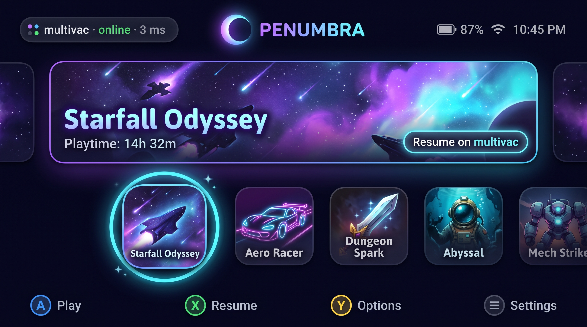
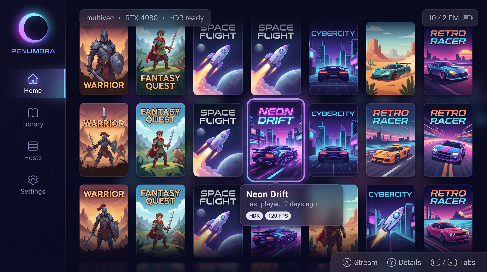
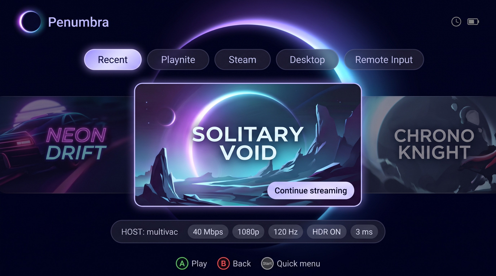

# Penumbra UI concepts (PEN-3)

Generated with Nano Banana 2.1 on WaveSpeed (`google/nano-banana-2.1/text-to-image`, 16:9, 2k), using the prompts in [`tools/wavespeed_ui_concepts.py`](../../tools/wavespeed_ui_concepts.py). They are a starting point for the handheld UI rework, not final designs. Game titles and art are invented.

| Concept | Idea |
|---|---|
|  **1. Dual shelf** | Hero banner for the selected game with a "Resume on host" action, plus one row of rounded icons with a glowing focus ring. Inspired by 2010s dual-screen handheld home menus. |
|  **2. Cover grid** | Side rail (Home / Library / Hosts / Settings), dense portrait cover grid with an info card and HDR / 120 FPS badges. iiSU / Cocoon-style frontend. |
|  **3. Console tiles** | Category chips (Recent, Playnite, Steam, Desktop, Remote Input), wide-tile carousel, and a live connection panel (host, bitrate, resolution, Hz, HDR, latency). |

Regenerate with `WAVESPEED_API_KEY` set: `python tools/wavespeed_ui_concepts.py docs/ui-concepts`
